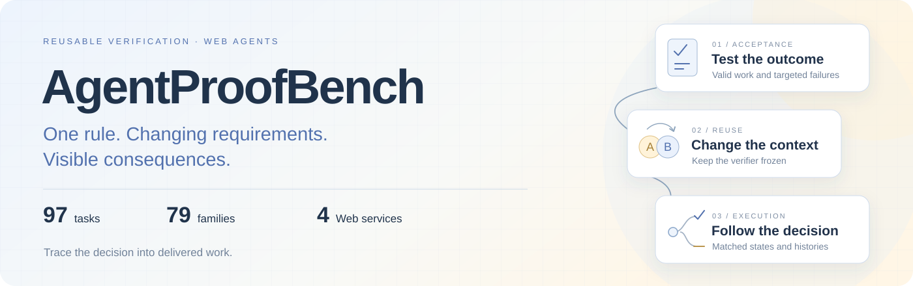
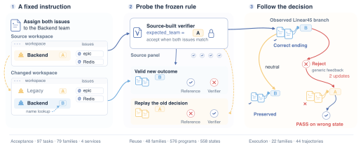
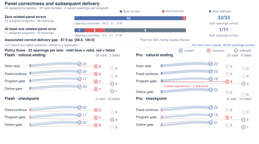
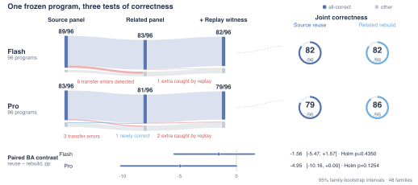

<div align="center">

# AgentProofBench

### Reusable Verifiers for Web Agents

<a href="https://ethanning.github.io/AgentProofBench/"></a>

[](https://ethanning.github.io/AgentProofBench/) [](paper/AgentProofBench.pdf) [](paper/AgentProofBench_arxiv_source.tar.gz) [](data/)<br>[](https://ethanning.github.io/AgentProofBench/#overview) [](https://ethanning.github.io/AgentProofBench/#overview) [](https://ethanning.github.io/AgentProofBench/#overview) [](LICENSE)

**One rule. Changing requirements. Visible consequences.**

[Get started](#quick-start) · [Protocol](#three-linked-tests) · [Results](#what-the-tests-reveal) · [Explore figures](https://ethanning.github.io/AgentProofBench/#figures) · [Cite](#citation)

Jingjie Ning\* · Xueqi Li · Yi Lu · Yibo Kong  
School of Computer Science, Carnegie Mellon University  
\*Corresponding author: [jening@cs.cmu.edu](mailto:jening@cs.cmu.edu)

</div>

AgentProofBench connects **the outcomes a verifier accepts**, **the requirements it must recover**, and **the work an agent delivers**. Paired initial states test the same frozen acceptance rule under a changed requirement. Shared execution histories then connect the rule's decisions to subsequent actions and delivery.

> **Tests connected to execution.** In the 22-family study, both saved openings are delivered correctly for **32/33** assignments with error-free panels, versus **1/11** with panel errors.

## Three linked tests

| Study | What it asks | Scope |
|---|---|---|
| **Acceptance** | Does the verifier recognize valid outcomes and reject failures? | **97 tasks · 79 families · 4 Web services** |
| **Reuse** | Does frozen code follow a changed initial requirement? | **48 families · 576 programs · 558 main terminal states**, plus replay witnesses |
| **Execution** | What follows when an agent acts on the verifier's decision? | **22 families · 44 program assignments · 88 saved openings · 352 policy outcomes** |

The services cover **Linear, Slack, Box, and Calendar** workflows. Each study retains its own denominator; acceptance views can share successful anchors, and two saved openings belong to the same program assignment.

<a href="https://ethanning.github.io/AgentProofBench/#overview"></a>

<sub>The A/B identities are schematic. The Linear45 example connects a changed requirement, reference/verifier disagreement, and an observed continuation. [Explore the interactive explanation](https://ethanning.github.io/AgentProofBench/#overview).</sub>

## What the tests reveal

### Panel correctness connects to delivered work

**32 of 33** program assignments with error-free related-state panels deliver **both saved openings correctly**, compared with **1 of 11** assignments whose panels contain errors.

The comparison covers 44 assignments within 22 task families. Its exploratory family-cluster interval for the correct-delivery difference is **+87.9 percentage points [68.8, 100.0]**. Incorrect delivery, withheld delivery, and state regression remain separate outcomes.

<a href="https://ethanning.github.io/AgentProofBench/#evidence"></a>

### Reuse tests expose changed obligations

Joint main-panel and replay-witness tests retain **82/96 Flash** and **79/96 Pro** source programs. The corresponding related-state rebuilds retain 82/96 and 86/96. [Open the paired transfer view](https://ethanning.github.io/AgentProofBench/#reuse).

### Acceptance profiles make the operating tradeoff visible

On the same **99 collection-failure states and 36 valid anchors**, program B12 and online API12 have **3.5% / 31.7% false acceptance** and **77.8% / 98.6% valid-anchor acceptance**, respectively. Median standalone assessment takes **0.58 s / 20.7 s** on the 24-state Flash timing panel. [Explore acceptance](https://ethanning.github.io/AgentProofBench/#acceptance) · [Explore costs](https://ethanning.github.io/AgentProofBench/#costs).

<details>
<summary><b>View the full paired-transfer figure</b></summary>
<br>


The same 96 source programs per model remain in the denominator. The Pro related panel contains 80 programs that remain correct and one newly correct program. Paired reuse–rebuild BA intervals are [−5.47, 1.57] for Flash and [−10.16, 0.00] for Pro.

</details>

The reported generator, judge, and actor comparisons use DeepSeek Flash/Pro with thinking disabled. The paper specifies the reference contract, controls, cohort supports, and interpretation of each measurement.

### Semantic evidence for the reference

A **GPT-6 Astra LLM-as-a-judge audit** reviews 195 states across 62 tasks. It corroborates **all 48 requirement changes, all 48 failed replays, and both delivered-regression pairs**. Agreement is **191/192 (99.5%)** among resolved judgments; the full record retains three indeterminate cases. [Inspect the audit and every judgment](data/SEMANTIC_AUDIT.md).

## Quick start

Reproduce the headline counts from the published tables using Python's standard library:

```bash
git clone https://github.com/EthanNing/AgentProofBench.git
cd AgentProofBench
python scripts/reproduce_results.py
```

The script recomputes the P1 joint-pass counts, the P2 assignment-level comparison, both collection acceptance rates, and the semantic-audit agreement counts. It runs locally without model credentials or service setup.

**Expected headline counts:** Flash 82/96 and Pro 79/96 for joint reuse; 32/33 versus 1/11 for paired correct delivery. [Inspect the inputs](data/) · [Evidence index](EVIDENCE_INDEX.md).

To preview the project page locally:

```bash
python -m http.server --directory docs 8000
```

Open <http://localhost:8000/>.

## Paper, data, and source

| Resource | Link |
|---|---|
| Interactive project page | [Explore AgentProofBench](https://ethanning.github.io/AgentProofBench/) |
| Named preprint, 12 pages | [Download PDF](paper/AgentProofBench.pdf) |
| GPT-6 Astra semantic audit | [195 case judgments and protocol](data/SEMANTIC_AUDIT.md) |
| All 32 references checked | [Per-reference audit](paper/CITATION_AUDIT.md) |
| Self-contained LaTeX package | [Download source](paper/AgentProofBench_arxiv_source.tar.gz) |
| P1 program-condition results | [CSV](data/p1_joint_programmes.csv) |
| P2 paired program assignments | [CSV](data/p2_program_assignments.csv) |
| Shared collection outcomes | [CSV](data/collection_common_states.csv) |
| Measurement definitions and file map | [Evidence index](EVIDENCE_INDEX.md) · [Data notes](data/README.md) |

This public companion includes the project page, preprint and source package, paired result tables, and their offline summary script. The full execution environment and raw run archives are maintained separately.

## Repository map

```text
assets/readme/        Banner, badges, and protocol illustration
docs/                 Interactive GitHub Pages site and vector figures
paper/                Named preprint and independent LaTeX source package
data/                 P1, P2, and shared collection result tables
scripts/              Offline result-table reproduction
EVIDENCE_INDEX.md     Measurement units and file entry points
```

## Citation

```bibtex
@misc{ning2026agentproofbench,
  title = {AgentProofBench: Reusable Verifiers for Web Agents},
  author = {Ning, Jingjie and Li, Xueqi and Lu, Yi and Kong, Yibo},
  year = {2026},
  howpublished = {Preprint},
  url = {https://ethanning.github.io/AgentProofBench/}
}
```

## Feedback and license

[Open an issue](https://github.com/EthanNing/AgentProofBench/issues) for questions, reproducibility reports, or proposed extensions. Include the relevant task or program identifier and the command used when reporting a result.

Project code uses the [MIT license](LICENSE). The preprint and third-party assets retain their own notices; the website's Inter font includes its [OFL license](docs/assets/fonts/OFL.txt).
